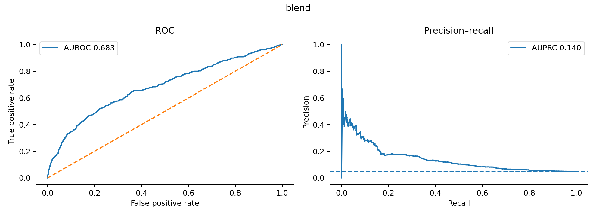
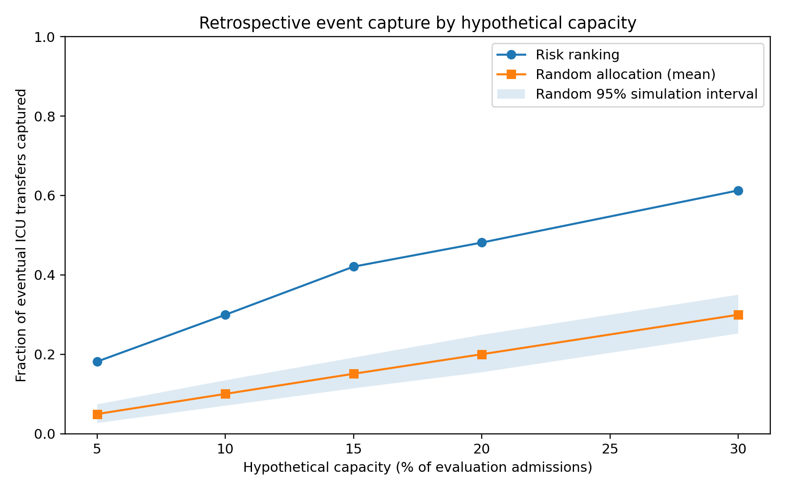
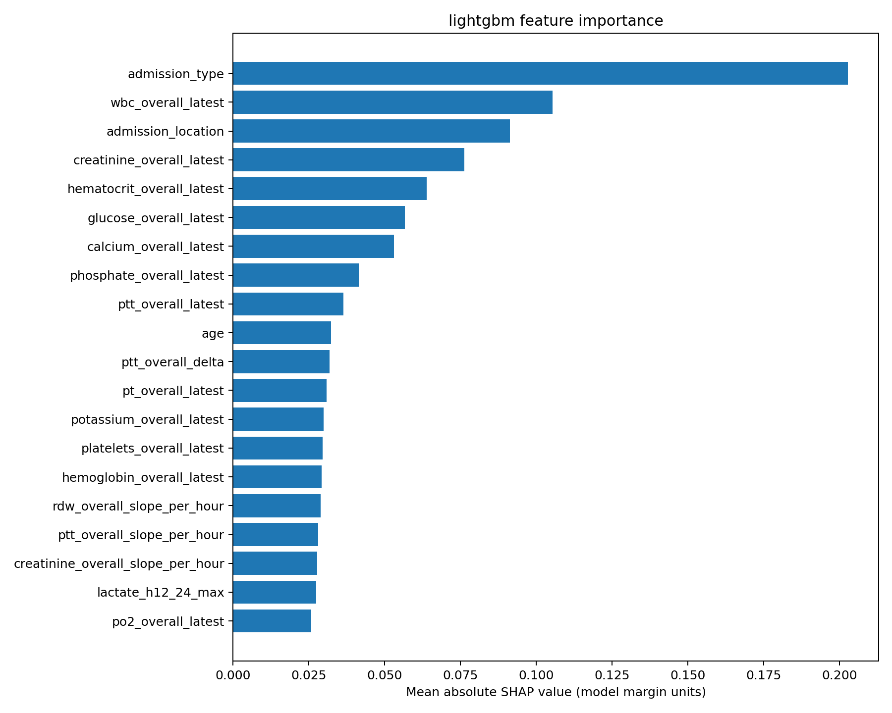
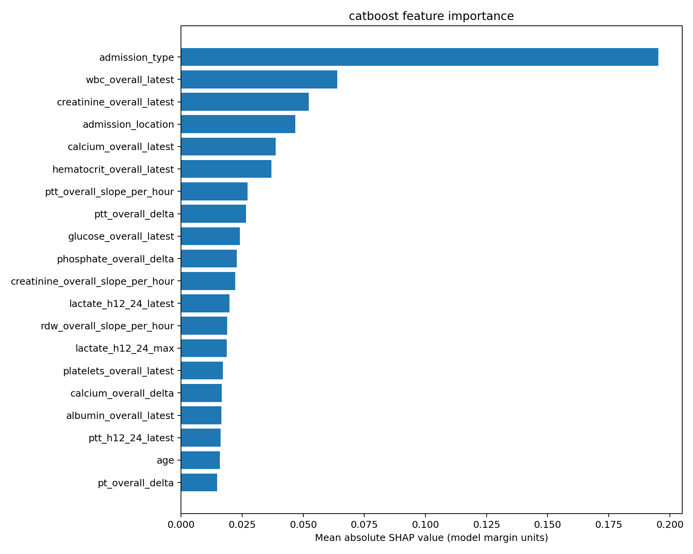
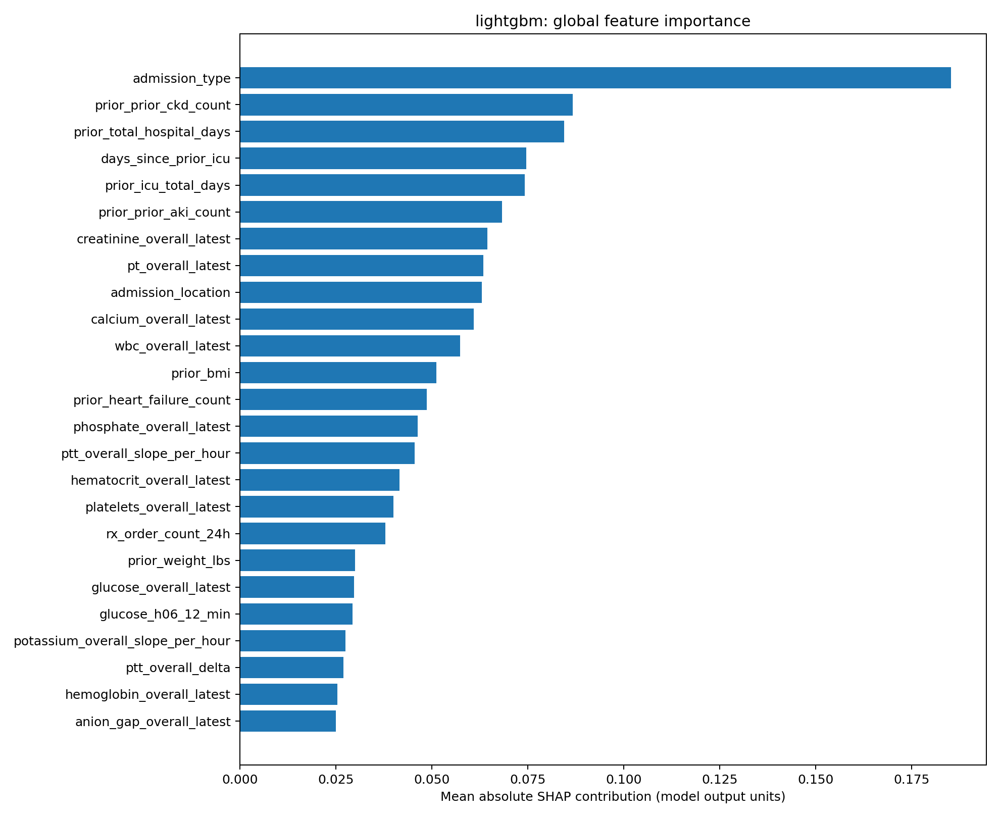
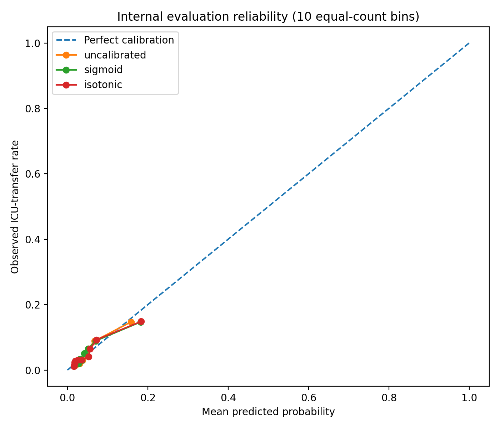
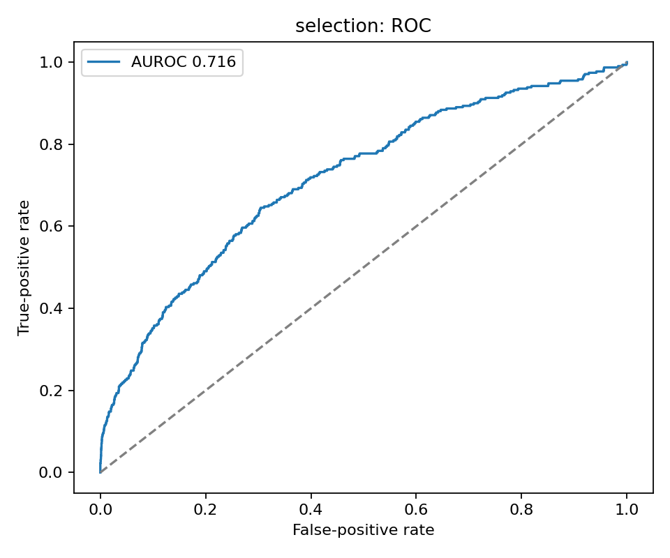
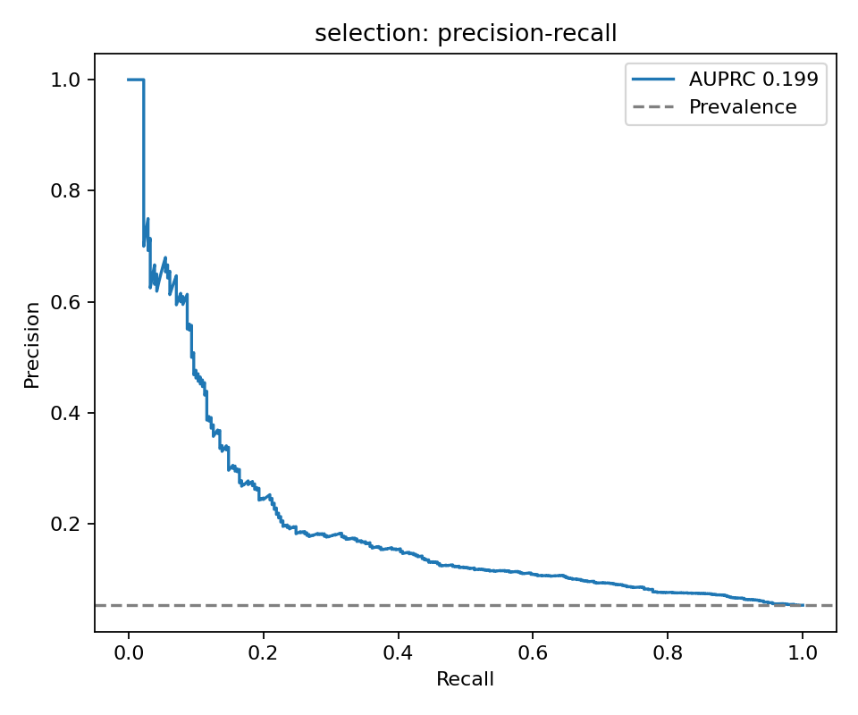
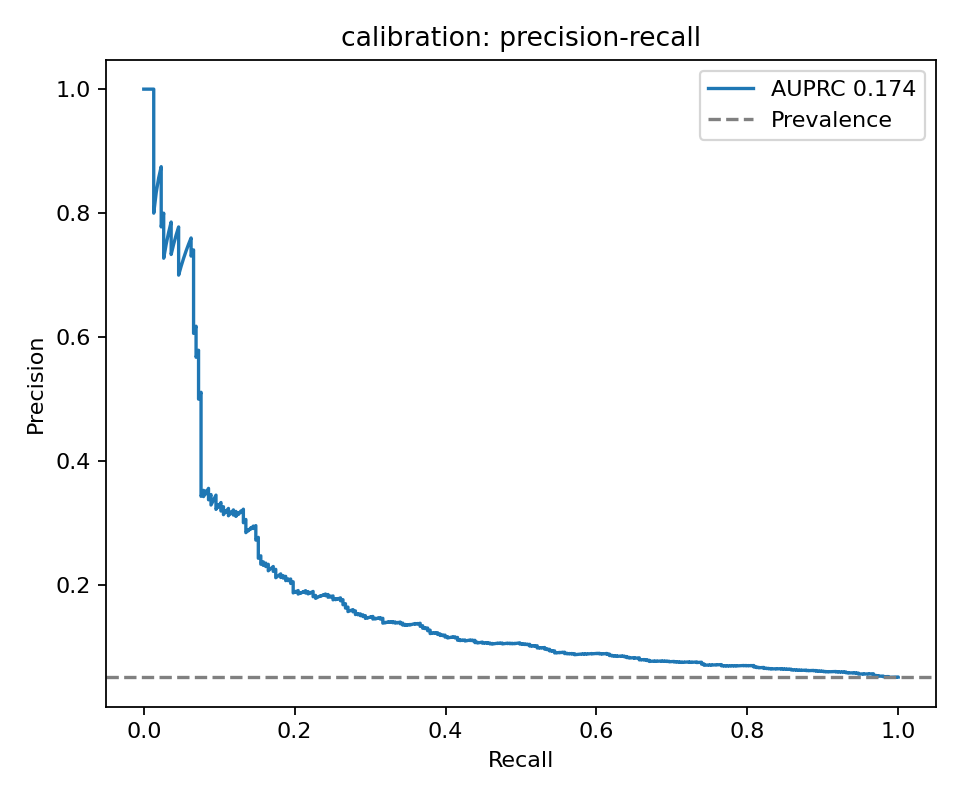

# Model results and figures

This directory contains aggregate model results and visualizations from multiple team experiments. For EBM results and plots, see the [EBM experiment index](ebm_experiments/README.md). The other tables below cover renal-cohort and neural-model experiments; their metrics should not be combined into a single leaderboard.

**Aggregate metrics only.** Do not commit MIMIC-IV records, individual prediction files, derived patient-level feature tables, trained weights, or patient-level SHAP explanations.

| File | Source in original results ZIP | Scope |
|---|---|---|
| [Phase 9C — all 15 models](phase9c_feature_ablation.csv) | `phase9c_outputs/ablation_results.csv` | Original retrospective renal cohort; 6,030 evaluation admissions, 302 ICU transfers |
| [Renal-trained neural models](renal_neural_comparison.csv) | `phase21_renal_outputs/validation_metrics.json` and `phase26_outputs/renal/report.json` | Newer renal subgroup; 8,565 validation admissions, 160 transfers |
| [Phase 30 MLP development](phase30_mlp_development.csv) | `phase30_outputs/development_report.json` and Phase 30 diagnostics | Original retrospective renal cohort; development partitions only |

## Highlights

**Phase 9C:** Five feature sets (553 baseline, 567 history, 563 medications, 576 comorbidities, 600 all) × LightGBM, CatBoost, and their weighted probability blend. Highest AUPRC: **0.214290** (all-feature blend, AUROC **0.760415**). The history-only CatBoost AUPRC (**0.203548**) exceeds the history blend (**0.197051**). The CSV's recall and precision use selected thresholds, **not top-10% recall**.

**Phase 21/26 renal-trained networks:** Phase 21 linear and deep discrete-time competing-risk models use **313 encoded inputs**. Phase 26 SHAP-selected binary MLP and neural competing-risk models use **122 encoded inputs** (100 selected numeric features). Highest AUPRC among these: **0.092762** (Phase 26 binary MLP). `recall_top10` measures event capture among the top 10% highest predicted risks. These are development-validation metrics, not independent external validation.

**Phase 30:** Optuna-tuned MLP with **1,009 input features**, depth 2, width 256, dropout ~0.331. Best selection AUPRC **0.199050**, not a held-out evaluation score. CSV values are rounded development diagnostic metrics; the development report confirms cohort and split sizes and best selection AUPRC.

## Figure gallery

All nine images below are existing experiment outputs. They are **retrospective descriptive plots**, not independent clinical validation. The source folder is reflected in each filename.

### Prediction discrimination — original renal model blend

**Original blend:** AUROC **0.683**, AUPRC **0.140** on the evaluation represented in this figure. This is a separate experiment from Phase 9C's all-feature blend (AUROC 0.7604, AUPRC 0.2143); do not label them as the same run. The precision–recall baseline is the positive-event prevalence.

### Retrospective event capture under hypothetical capacity

**Phase 6:** At a hypothetical 10% selection capacity, the plotted risk ranking captures approximately 30% of subsequent transfers versus approximately 10% under random selection. This is **not** a prospective ICU-bed allocation trial or evidence of improved outcomes.

### Feature attribution

| LightGBM | CatBoost |
|---|---|
|  |  |

Both models give high importance to **admission type** and other administrative/clinical variables. SHAP magnitude is a measure of model attribution, **not causality**; high administrative importance warrants workflow-dependence and leakage investigation.

**Phase 10:** Prior CKD/AKI history, hospital utilization, admission type, and clinical measurements appear among influential predictors. These are model-specific attributions and should not be compared numerically with Phase 5 without matched models and data.

### Probability calibration

**Phase 4B:** Ten equal-count bins compare mean predicted probability against observed ICU-transfer frequency. Most plotted predictions lie below 0.2, so the full 0–1 axes visually compress the informative region. Refer to numerical calibration metrics before claiming improvement.

### Phase 30 — Optuna-tuned MLP, development partitions only

| Model-selection ROC | Model-selection precision–recall |
|---|---|
|  |  |

**Phase 30:** Selection AUROC **0.716** and AUPRC **0.199**; calibration-partition AUPRC **0.174**. These are **different development partitions**, and the selection partition was used for tuning. The drop does not alone establish overfitting, and neither figure represents untouched held-out test performance.

## Methodological cautions

- **Do not directly compare AUPRC between Phase 9C, Phase 21/26, and Phase 30.** Their cohorts, prevalences, and evaluation partitions differ.
- Retrospective AKI/CKD coding may include information recorded after the 24-hour prediction landmark.
- Lab result availability (`storetime`) and medication/microbiology provenance are not fully verified; staged labs can omit `storetime`.
- Repeated development-validation inspection risks optimistic selection estimates.
- ICU transfer is an observed care-utilization outcome, not necessarily clinical need for ICU admission.
- No claim of clinical deployment readiness or independent external validation is made.

Canonical code locations: [research source index](../src/README.md).

---

## EBM experiments

See the [EBM experiment archive](ebm_experiments/README.md) for aggregate metrics, methodology caveats, and the supplied experiment inventory. This is separate from the curated historical results above; do not combine metrics across the two archives as though they are from a single benchmark.
